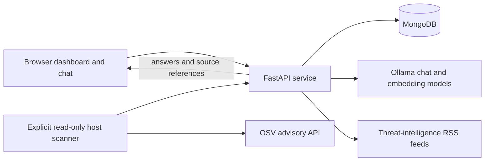

# SignalWatch

**Threat Intelligence Chat: Building and Deploying an LLM/SLM-backed Chat Application on MongoDB**

SignalWatch is a defensive, local-first coursework application for exploring threat intelligence and MongoDB lab material through a chat interface. It combines a FastAPI backend, MongoDB persistence, Ollama chat and embedding models, a responsive dashboard, RSS intelligence leads, and an explicitly run, read-only host inventory scanner.

> **Course:** 23CSE528 — NoSQL Databases using MongoDB  
> **Assessment scope:** Integrated concepts and preserved source materials from MongoDB Labs 7–18.

## Features

- **Cited RAG chat:** retrieves course and project sources from MongoDB, uses Ollama embeddings with lexical fallback, cites returned sources, and supports multi-turn follow-ups.
- **Persistent conversations:** saves messages in MongoDB; restore a session, start a new one, or clear its history from the dashboard.
- **Threat lifecycle:** add, edit, search, filter, and delete records in Anticipated, Active, Evolving, or Resolved states.
- **Intelligence leads:** import RSS items from CISA, BleepingComputer, and The Hacker News. Feed items remain unreviewed and are not automatically treated as active threats.
- **Read-only inventory:** an opt-in host scanner inventories supported package managers and Python packages, queries OSV where supported, and submits findings for review. It does not modify the computer.
- **Operations:** health and metrics endpoints, optional API-token protection, rate limiting, Dockerfile, and Docker Compose configuration.

Seeded demonstration threats are clearly marked `DEMO ONLY`; they are synthetic examples, not current advisories.

## Architecture



MongoDB stores threat records, scans, findings, RSS leads, knowledge chunks and conversation messages. Local MongoDB Community uses API-side cosine ranking rather than Atlas `$vectorSearch`.

## Quick start with Docker Compose

### Prerequisites

- Docker Desktop with Docker Compose
- Ollama installed and running on the host
- A chat model and (optionally) the embedding model available in Ollama

Example model setup:

```bash
ollama pull llama3.2:3b
ollama pull nomic-embed-text
```

1. Copy the example environment file and edit it:

   ```bash
   cp .env.example .env
   ```

   Set `OLLAMA_MODEL` to an installed chat model and set `API_TOKEN` to a long, unique secret. Keep `.env` private and never commit it.

2. Ensure the container can reach Ollama. Docker Desktop commonly uses `host.docker.internal`; set `OLLAMA_BASE_URL` accordingly. If Ollama only listens on loopback, configure its host binding for Docker access and restrict that port to trusted local use.

3. Build and start:

   ```bash
   docker compose up --build -d
   docker compose ps
   ```

4. Open:

   - Dashboard: <http://localhost:8000/>
   - Health: <http://localhost:8000/health>
   - API documentation: <http://localhost:8000/docs>

When `API_TOKEN` is configured, use **Set API key** in the dashboard. The key is held in browser `sessionStorage` for that tab. Health, the dashboard shell, documentation, and static assets remain accessible without the key; API data and actions require it.

## Run locally without the API container

Run MongoDB and Ollama separately, then install the Python requirements and start FastAPI:

```bash
python3 -m venv .venv
source .venv/bin/activate
python -m pip install -r app/requirements.txt

export MONGO_URI='mongodb://127.0.0.1:27017/'
export MONGO_DB='signalwatch'
export OLLAMA_BASE_URL='http://127.0.0.1:11434'
export OLLAMA_MODEL='llama3.2:3b'
export OLLAMA_EMBED_MODEL='nomic-embed-text'

python -m uvicorn app.main:app --host 127.0.0.1 --port 8000
```

Set `API_TOKEN` in the same environment if API protection is required. With no token configured, API access is open; do not expose that configuration outside a trusted local environment.

## Host inventory scanner

Run the scanner on the computer to be inventoried, not inside the API container. Install its `requests` dependency if needed:

```bash
python3 -m pip install requests
export SIGNALWATCH_API='http://localhost:8000'
# If API_TOKEN is set, provide the same value through SIGNALWATCH_API_KEY.
export SIGNALWATCH_API_KEY='your-configured-token'
python3 host_agent/scan_host.py
```

On Windows, use `py host_agent/scan_host.py`. The scanner submits package names, versions, and advisory matches to the local API. OSV queries transmit package/version identifiers to the OSV service. Findings require analyst review and are not proof of exploitation.

## Chat API example

```bash
curl -X POST http://localhost:8000/api/chat \
  -H 'Content-Type: application/json' \
  -H "X-API-Key: $SIGNALWATCH_API_KEY" \
  -d '{"message":"Explain MongoDB replica-set failover using the course sources","session_id":"demo-session","platform":"Linux"}'
```

The response contains an answer, a session ID, the selected model, and retrieved source references. For conversation controls, use `GET /api/chat/{session_id}` to restore history and `DELETE /api/chat/{session_id}` to clear it.

## Main API routes

| Method | Route | Purpose |
|---|---|---|
| `GET` | `/health` | MongoDB and Ollama availability |
| `GET` | `/metrics` | Request, error, latency, and model-token counters |
| `GET`, `POST` | `/api/threats` | List/search/filter or create threat records |
| `PATCH`, `DELETE` | `/api/threats/{id}` | Edit or remove a threat record |
| `POST` | `/api/chat` | RAG chat with persisted session memory |
| `GET`, `DELETE` | `/api/chat/{session_id}` | Restore or clear a chat session |
| `POST` | `/api/scan` | Receive a scanner inventory |
| `GET` | `/api/findings` | Filter and list scanner findings |
| `POST` | `/api/feeds/refresh` | Refresh external RSS leads |
| `GET` | `/api/feeds` | List stored feed leads |

Use `/docs` for request schemas and interactive API documentation.

## RAG and data model

At startup the application seeds curated lab concepts and indexes supported source files from `legacy_labs/`. Text chunks and Ollama embeddings are stored in the `knowledge` collection. Retrieval uses cosine similarity when embeddings are available and a title-weighted lexical score as a fallback. The chat prompt includes recent session messages and relevant threat, finding, and feed records; source references are returned to the browser.

MongoDB collections used by the application:

- `threats` — lifecycle and evidence records
- `scans` — submitted host inventories
- `findings` — advisory matches and review status
- `knowledge` — curated and ingested passages with embeddings
- `feed_reports` — deduplicated, unreviewed RSS leads
- `messages` — user and assistant messages indexed by session

## Project layout

```text
app/
  main.py                 FastAPI API, RAG, MongoDB, Ollama integration
  static/                 Dashboard and chat frontend
host_agent/
  scan_host.py            Explicit read-only host inventory scanner
legacy_labs/
  lab07/ ... lab18/        Preserved course source materials
reports/
  generate_report.py      Rebuilds the assessment report PDF
  requirements.txt        Report-generation dependency
tests/
  static_checks.py         Offline structural checks
Dockerfile
docker-compose.yml
FINAL_ASSESSMENT_REPORT.pdf
```

## Validation

Run the lightweight offline checks:

```bash
python3 tests/static_checks.py
python3 -m py_compile app/main.py host_agent/scan_host.py
node --check app/static/app.js
```

Regenerate the report (requires `reportlab`):

```bash
python3 -m pip install -r reports/requirements.txt
python3 reports/generate_report.py
```

## Safety and limitations

- SignalWatch provides defensive information only. It does not run model-generated commands or perform remediation.
- Scanner results and RSS items are advisory leads; verify them against authoritative vendor sources before acting.
- The scanner is not a full malware, filesystem, kernel, driver, mobile-device, or remote endpoint scan.
- Platform selection filters stored information; it does not remotely scan other devices.
- MongoDB Community does not provide Atlas `$vectorSearch`; the local implementation ranks vectors in the API.
- API-token protection is optional and is a shared token, not per-user login or full tenant isolation. Configure TLS, MongoDB authentication, user authorization, and a production-grade rate limiter before external deployment.
- The Docker configuration is provided for reproducibility. Validate the image build and deployment in the target environment before relying on it.

## Assessment report

`reports/generate_report.py` generates `FINAL_ASSESSMENT_REPORT.pdf` locally. The PDF contains student-identifying information and is excluded from Git by default. Submit it through the assessment portal or add it only if you intend to store it in a private repository.

The assessment instructions specify a **private GitHub repository**. Confirm the repository visibility is private before uploading the project.
